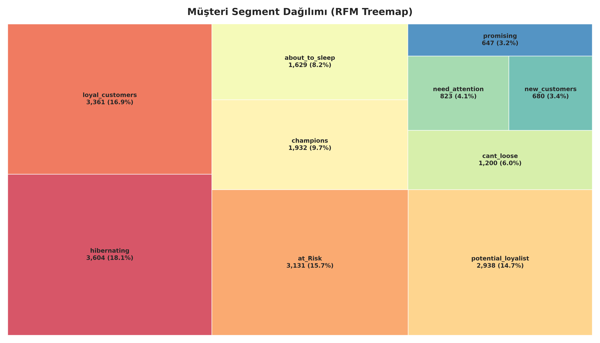
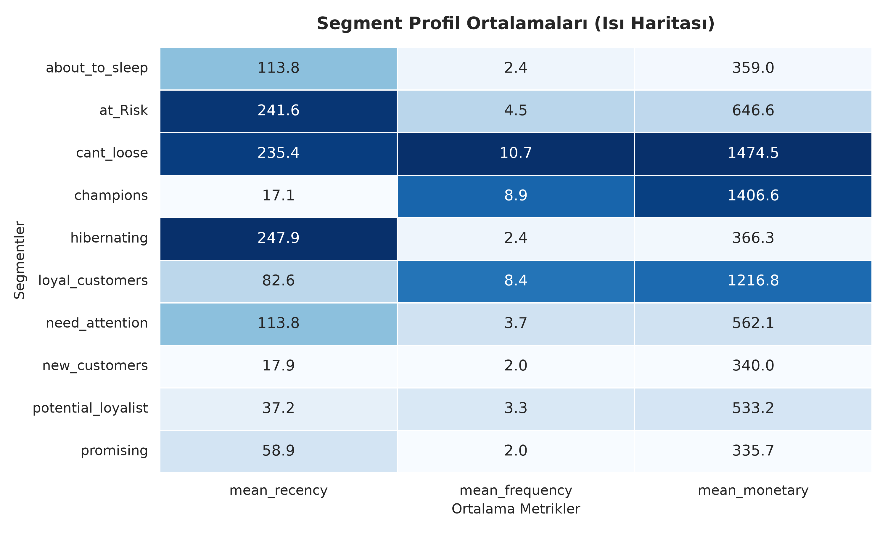
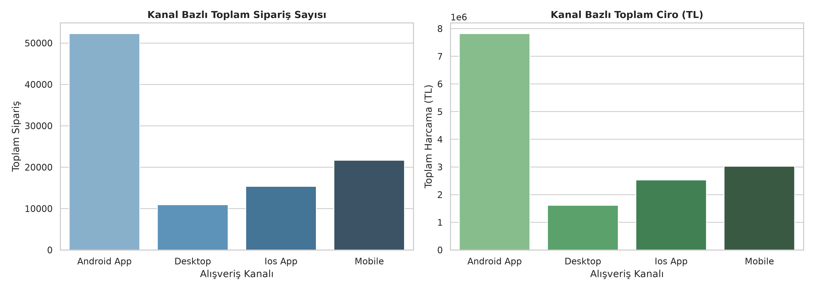

# FLO Omnichannel Müşteri Segmentasyonu ve RFM Analitiği

FLO'nun online ve fiziksel mağaza müşterilerinin alışveriş davranışlarını **RFM (Recency, Frequency, Monetary)** yöntemiyle analiz eden; müşteri segmentleri, pazarlama hedef kitleleri ve görsel raporlar üreten modüler bir Python projesi. **Streamlit** arayüzüyle segmentler filtrelenebilir ve seçilen müşteri listeleri CSV olarak indirilebilir.

## İş problemi ve veri seti

Amaç, müşterileri satın alma sıklığı, son alışveriş zamanı ve harcama tutarına göre gruplandırarak kişiselleştirilmiş kampanyalar için kullanılabilir hedef kitleler oluşturmaktır.

- **Veri:** FLO omnichannel müşteri alışveriş geçmişi (2020–2021)
- **Kapsam:** 19.945 tekil müşteri, 12 ham değişken
- **Temel alanlar:** `master_id`, alışveriş kanalları, ilk/son alışveriş tarihleri, online/offline sipariş adetleri ve harcamaları, ilgi duyulan ürün kategorileri
- **Toplam geçmiş harcama:** 14.983.567,31 TL (veri setindeki müşteri harcamalarının toplamı)

## Veri seti erişimi

> **Önemli:** Ham FLO veri setinin yeniden dağıtımına izin verilmediğinden `flo_data_20k.csv` bu GitHub deposunda paylaşılmamaktadır. Analizi çalıştırmak için veri setine yetkili erişiminiz olmalı ve dosyayı `data/raw/flo_data_20k.csv` konumuna yerleştirmelisiniz. Müşteri bazlı analiz ve kampanya CSV çıktıları da depoya dahil edilmez.

## Yöntem ve uygulama

1. **Veri hazırlama (`src/data_prep.py`):** Tarih sütunları `datetime` tipine dönüştürülür; online/offline sipariş ve harcamalar birleştirilerek toplam metrikler hesaplanır. Dijital kanal eğilimini göstermek için `online_order_ratio` ve `online_value_ratio` türetilir.
2. **RFM analizi (`src/rfm_engine.py`):** Recency, veri setindeki en güncel alışveriş tarihinin iki gün sonrası referans alınarak hesaplanır (analiz tarihi isteğe bağlı değiştirilebilir). Frequency toplam sipariş, Monetary toplam harcama değeridir. `pd.qcut` ile 1–5 skorları üretilir; Frequency için `rank(method="first")` kullanılır. Recency ve Frequency skorları birleştirilerek `RF_SCORE` oluşturulur ve regex tabanlı haritayla **10 segmente** atanır.
3. **Pazarlama aksiyonları (`src/business_actions.py`):** Segment, ürün kategorisi ve isteğe bağlı minimum Monetary skoru kullanılarak hedef kitleler belirlenir. Segmentlerin müşteri sayısı, ortalama RFM değerleri, toplam harcaması ve ciro payı raporlanır.
4. **Görselleştirme (`src/visualizer.py`):** Segment dağılımı için treemap, ortalama RFM değerleri için normalize renk skalalı heatmap ve `order_channel` gruplarındaki müşterilerin toplam sipariş/harcama hacimleri için bar grafikler oluşturulur.
5. **Karar destek paneli (`app.py`):** Müşteri sayısı, toplam ciro, müşteri başına ortalama sipariş ve en kalabalık segment KPI'ları; segment/kategori/harcama filtreleri; grafikler ve müşteri ID'lerini CSV indirme işlevi sunulur.

> **Kanal grafikleri hakkında:** `order_channel` bazındaki toplamlar, ilgili gruptaki müşterilerin **online + offline tüm geçmiş işlemlerini** içerir; tek tek kanallarda gerçekleşen satış tutarı olarak yorumlanmamalıdır.

## Görselleştirmeler

### RFM segment dağılımı



### Segment bazlı RFM profili



### Sipariş kanalı gruplarına göre toplam işlem hacmi



> Grafikler toplulaştırılmış analiz çıktılarıdır. Kanal grubu grafiği, her gruptaki müşterilerin toplam online ve offline işlemlerini birlikte kapsar.

## Analiz sonuçları

| Gösterge | Sonuç |
|---|---:|
| En kalabalık segment | `hibernating` — 3.604 müşteri |
| Sadık müşteri segmenti | `loyal_customers` — 3.361 müşteri |
| Champions | 1.932 müşteri |
| Yeni lüks kadın markası kampanyası | **2.497 müşteri** |
| Erkek/çocuk ürünleri indirim kampanyası | **2.985 müşteri** |

**Kampanya A:** `champions` veya `loyal_customers` segmentinde olup `KADIN` kategorisinde alışveriş geçmişi bulunan müşteriler.

**Kampanya B:** `cant_loose`, `at_Risk`, `hibernating` veya `new_customers` segmentinde olup `ERKEK` ya da `ÇOCUK` kategorisiyle ilgilenen müşteriler.

Hedef kitlelerin `master_id` listeleri `data/processed/` altında CSV olarak kaydedilir.

## Proje yapısı

```text
flo-omnichannel-customer-segmentation/
├── data/
│   ├── raw/                    # Yerel veri seti (GitHub'da yok)
│   └── processed/              # Yerel müşteri bazlı çıktılar (GitHub'da yok)
├── reports/figures/            # Treemap, heatmap, kanal grafikleri
├── src/
│   ├── data_prep.py
│   ├── rfm_engine.py
│   ├── business_actions.py
│   └── visualizer.py
├── tests/
│   ├── test_data_prep.py
│   └── test_rfm_engine.py
├── app.py                      # Streamlit paneli
├── main.py                     # Analiz hattı
├── pytest.ini
├── requirements.txt
├── .gitignore
└── README.md
```

## Kurulum ve çalıştırma

Python 3.10+ önerilir. Komutları proje kök dizininde çalıştırın. Ham veri dosyası `data/raw/flo_data_20k.csv` konumunda bulunmalıdır.

```bash
python -m venv .venv
```

Windows PowerShell: `.venv\Scripts\Activate.ps1`  
macOS/Linux: `source .venv/bin/activate`

```bash
pip install -r requirements.txt
python main.py             # Analiz, görseller ve CSV çıktıları
python -m pytest          # Birim testleri
streamlit run app.py      # İnteraktif panel
```

`main.py` çalıştırıldığında `data/processed/` ve `reports/figures/` klasörleri oluşturulur. Paneldeki hedef kitle filtresi, seçilen müşteri ID'lerinin ayrıca indirilmesini sağlar.

## Testler ve teknoloji

**Teknolojiler:** Python, pandas, NumPy, Matplotlib, Seaborn, Squarify, Streamlit, pytest.

Pytest testleri; tarih dönüşümleri, toplam sipariş/harcama ve online sipariş oranları, RFM skor aralıkları, RF skoru biçimi ve örnek veri üzerinde segmentasyon çıktısını kontrol eder. Testler, gerçek FLO veri seti yerine örnek veri kullanılarak çalıştırılabilir. Test sonuçlarını doğrulamak için `python -m pytest` komutunu çalıştırın.

## Kaynak ve geliştirmeler

Projenin temel RFM yaklaşımı, segment haritası ve iki kampanya senaryosu **Miuul – _RFM Analizi ile Müşteri Segmentasyonu_** eğitim çalışmasına dayanmaktadır. Bu uygulamada temel çalışma; **modüler Python mimarisi, dijital kanal oranları, parametreli analiz fonksiyonları, yeniden kullanılabilir hedef kitle filtreleme, segment bazlı iş raporları, otomatik grafik üretimi, Streamlit paneli ve pytest testleri** ile genişletilmiştir.
